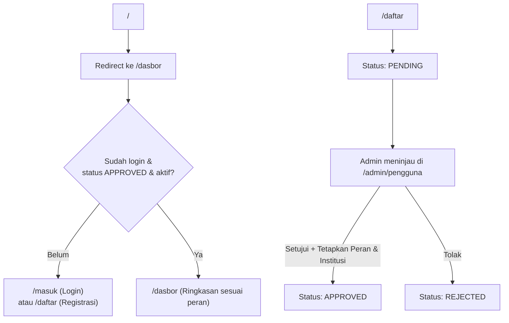
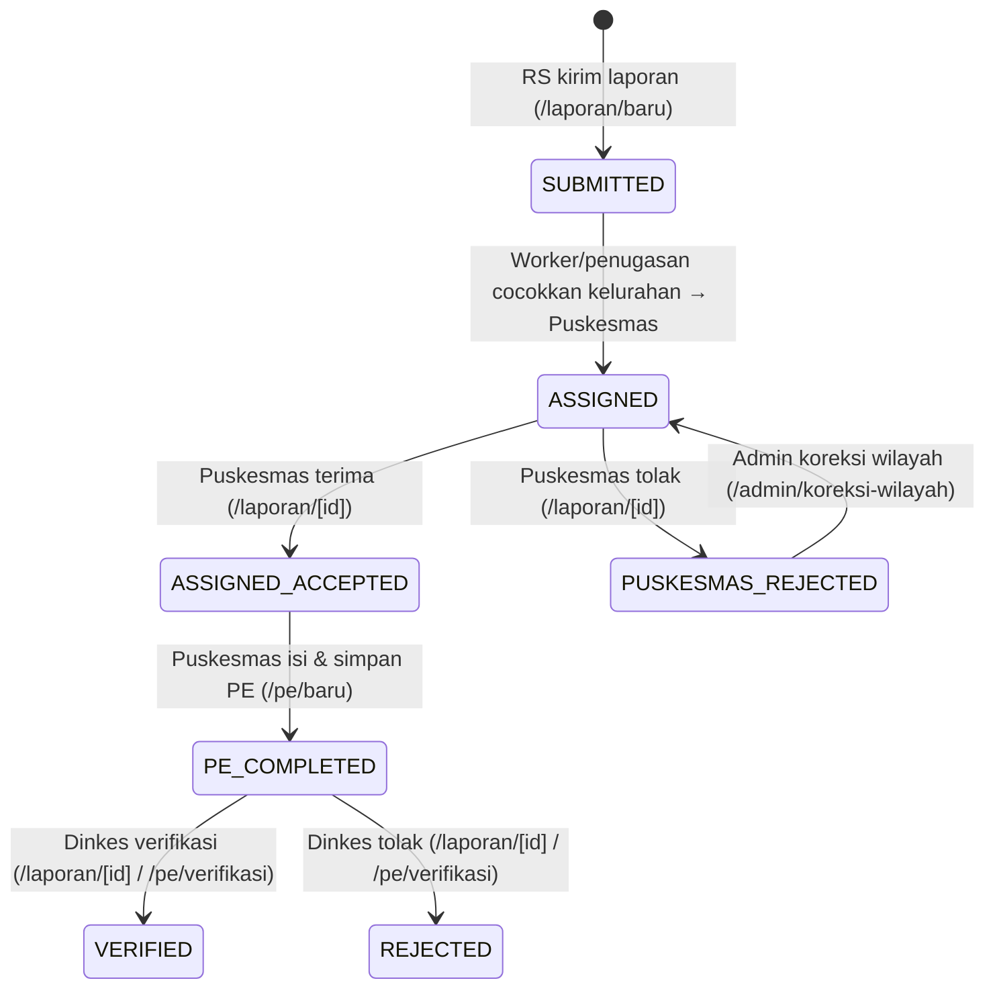

# Alur Website WALI-EPI

Dokumen ini menjelaskan alur autentikasi, pembagian peran, peta rute, dan siklus hidup pelaporan kasus DBD hingga penyelidikan epidemiologi (PE) di aplikasi **WALI-EPI**.

---

## 1. Gambaran Umum & Autentikasi

- **Rute publik:** `/masuk`, `/daftar`, `/api/health`, `/api/auth/[...all]`.
- **Akun baru** yang mendaftar melalui `/daftar` berstatus `PENDING` hingga disetujui oleh `ADMIN` dan dihubungkan ke peran/institusi (`RUMAH_SAKIT`, `PUSKESMAS`, atau `DINKES`).
- **Akun nonaktif / ditolak** tidak dapat membuat sesi baru dan diblokir di batas sesi.

---

## 2. Peran Pengguna & Akses Menu

| Peran | Fokus Utama | Menu Utama |
| --- | --- | --- |
| **RUMAH_SAKIT** | Input laporan kasus DBD dari RS dan memantau tindak lanjut | `/dasbor`, `/laporan`, `/laporan/baru`, `/laporan/perlu-action`, `/laporan/analitik`, `/notifikasi`, `/pesan` |
| **PUSKESMAS** | Menerima/menolak penugasan kasus wilayahnya & melaksanakan PE | `/dasbor`, `/laporan`, `/laporan/perlu-action`, `/pe`, `/pe/tugas`, `/pe/baru`, `/aset`, `/notifikasi`, `/pesan` |
| **DINKES** | Monitoring kota/kabupaten, verifikasi hasil PE & laporan, analitik epidemiologi | `/dasbor`, `/laporan`, `/laporan/perlu-action`, `/laporan/monitoring`, `/laporan/analitik`, `/pe`, `/pe/verifikasi`, `/pe/analitik`, `/notifikasi`, `/pesan` |
| **ADMIN** | Kelola pengguna, institusi, data master kelurahan, koreksi wilayah, audit log | `/dasbor`, `/admin/pengguna`, `/admin/pengguna/baru`, `/admin/institusi`, `/admin/kelurahan`, `/admin/koreksi-wilayah`, `/admin/audit-log`, `/notifikasi`, `/pesan` |

Semua peran juga memiliki akses ke `/pengaturan` untuk profil & keamanan akun.

---

## 3. Alur Utama: Pelaporan Kasus RS → Penyelidikan Epidemiologi (PE) → Verifikasi Dinkes

### Langkah Detail

1. **Rumah Sakit melapor kasus (`/laporan/baru`)**
   - Petugas RS mengisi *Identitas pasien* (nama, NIK 16 digit, umur, jenis kelamin, telepon, alamat), *Wilayah domisili* (bisa auto-fill dari kelurahan terdaftar atau input manual), dan *Data klinis* (`DENGUE`, `SUSPECTED_DENGUE`, `DHF`, `DSS`, tanggal masuk RS, trombosit, catatan diagnosis).
   - Data PII (NIK, alamat, nomor telepon) dienkripsi di server sebelum disimpan; laporan tercatat dengan status `SUBMITTED`.
   - Job BullMQ (`assign`) dipicu di background untuk mencocokkan `kelurahan` pasien ke Puskesmas pengampu.

2. **Penugasan Otomatis ke Puskesmas**
   - Jika kelurahan cocok dengan data master Puskesmas, status menjadi `ASSIGNED` (`Menunggu puskesmas`) dan notifikasi dikirim ke institusi Puskesmas terkait (`/notifikasi`).
   - Jika tidak cocok atau salah wilayah, laporan dapat dikoreksi oleh Admin di `/admin/koreksi-wilayah`.

3. **Puskesmas meninjau penugasan (`/laporan/perlu-action` → `/laporan/[id]`)**
   - Puskesmas melihat laporan masuk, memeriksa detail pasien (dekripsi PII diaudit ke `audit_log`), lalu memilih:
     - **Terima (`ACCEPT`)** → status `ASSIGNED_ACCEPTED`.
     - **Tolak (`REJECT`)** → status `PUSKESMAS_REJECTED` (dengan alasan penolakan, agar Admin dapat melakukan koreksi wilayah).

4. **Puskesmas melakukan Penyelidikan Epidemiologi (`/pe/tugas` → `/pe/baru`)**
   - Untuk laporan berstatus `ASSIGNED_ACCEPTED`, Puskesmas melakukan survei lapangan / survei jentik per rumah tangga (`peHouseholdSurveys`) dan mengisi formulir PE di `/pe/baru` (mendukung unggah foto/lampiran melalui `/api/attachments` & `/aset`).
   - Menyimpan PE mengubah status laporan menjadi `PE_COMPLETED`.

5. **Dinkes memantau & memverifikasi (`/pe/verifikasi`, `/laporan/monitoring`, `/laporan/[id]`)**
   - Dinkes memantau SLA, antrean tugas, dan peta sebaran wilayah (menggunakan `/api/geo/boundary` dan `/api/tiles/[z]/[x]/[y]`).
   - Dinkes meninjau hasil PE lalu memilih **Verifikasi (`VERIFY` → `VERIFIED`)** atau **Tolak (`REJECT_BY_DINKES` → `REJECTED`)**.

---

## 4. Alur Administrasi & Master Data (`ADMIN`)

1. **Manajemen Pengguna (`/admin/pengguna`, `/admin/pengguna/baru`)**
   - Menyetujui atau menolak akun pendaftar baru (`PENDING` → `APPROVED` / `REJECTED`) sekaligus menetapkan peran dan institusi.
   - Menambah akun langsung, mengedit profil/peran/institusi/reset password, serta mengaktifkan/menonaktifkan akun (nonaktifkan atau ubah kredensial mencabut sesi aktif).
2. **Master Institusi & Kelurahan (`/admin/institusi`, `/admin/kelurahan`)**
   - Mengelola daftar Rumah Sakit, Puskesmas, dan Dinkes beserta pemetaan kelurahan pengampu (termasuk GeoJSON boundary wilayah).
3. **Koreksi Wilayah (`/admin/koreksi-wilayah`)**
   - Mengalihkan penugasan ulang laporan yang kelurahannya belum terpetakan atau ditolak Puskesmas.
4. **Audit Log (`/admin/audit-log`)**
   - Merekam seluruh aksi sensitif (dekripsi PII pasien, persetujuan/edit akun, perubahan status laporan, dan perubahan master data).

---

## 5. Fitur Pendukung & Worker Background

- **Pesan Internal (`/pesan`, `/pesan/[id]`):** Komunikasi antar-petugas/institusi terkait tindak lanjut kasus.
- **Notifikasi (`/notifikasi`):** Pemberitahuan penugasan laporan baru, pengingat SLA, dan perubahan status.
- **Analitik & Ekspor (`/laporan/analitik`, `/pe/analitik`):** Grafik tren kasus, indeks jentik/ABJ, serta ekspor Excel via worker (`exceljs`).
- **Background Worker (`src/worker/index.ts` via BullMQ + Redis):**
  - `assign`: Penugasan otomatis laporan baru ke Puskesmas berdasarkan kelurahan.
  - `sla`: Pengingat keterlambatan peninjauan/PE.
  - `notify`: Pengiriman notifikasi asinkron.
  - `export`: Pembuatan file laporan Excel secara asinkron.
