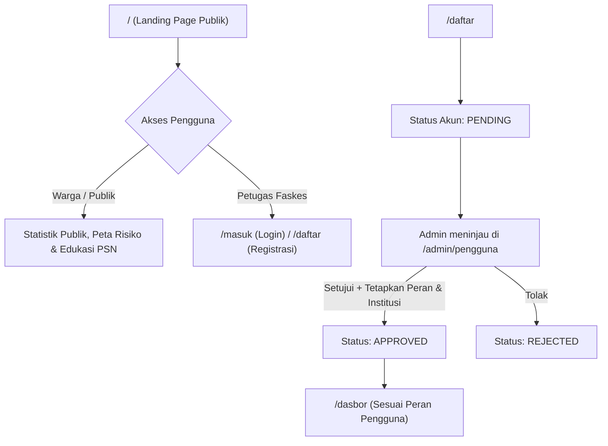
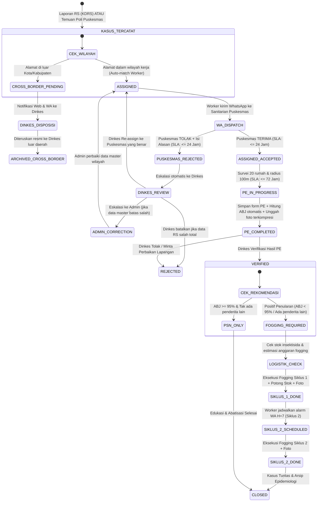

# Alur Website WALI-EPI (Surveilans & Penyelidikan Epidemiologi DBD)

Dokumen ini menjelaskan alur operasional, pembagian peran, siklus hidup pelaporan kasus DBD/DD, integrasi formulir resmi Penyelidikan Epidemiologi (PE) berbasis standar Kemenkes/Dinkes, kalkulator otomatis indikator entomologi, deteksi kluster spasial radius 100 meter, kepatuhan batas waktu (SLA) terintegrasi WhatsApp Dispatch, pipeline kompresi otomatis berkas unggahan, manajemen logistik & anggaran fogging, generator PDF siap cetak, serta tata letak halaman publik sambutan (*welcome landing page*) di aplikasi **WALI-EPI**.

---

## 1. Gambaran Umum & Autentikasi

- **Rute Publik:** 
  - `/` : *Welcome One-Page Landing* (Menampilkan statistik agregat, visualisasi alur respon, status kewaspadaan kelurahan, dan edukasi pencegahan DBD warga tanpa menampilkan data pribadi/PII pasien).
  - `/masuk` : Halaman login petugas terdaftar.
  - `/daftar` : Registrasi akun tenaga kesehatan/faskes baru.
  - `/api/health`, `/api/auth/[...all]`.
- **Akun Baru** yang mendaftar melalui `/daftar` berstatus `PENDING` hingga disetujui oleh `ADMIN` dan dihubungkan ke peran/institusi (`RUMAH_SAKIT`, `PUSKESMAS`, atau `DINKES`).
- **Akun Nonaktif / Ditolak** dibatalkan sesinya dan dilarang membuat token sesi baru.

---

## 2. Peran Pengguna & Pembagian Menu

| Peran | Fokus Utama & Wewenang | Menu Utama |
| --- | --- | --- |
| **PUBLIK (Warga)** | Memantau status risiko kelurahan, memahami alur fogging, dan pedoman PSN 3M | `/` *(Welcome Landing Page)* |
| **RUMAH_SAKIT** | Input KDRS (kasus DBD, DD, SSD), upload hasil lab/serologi terkompresi, deteksi pasien luar wilayah, monitoring tindak lanjut Puskesmas | `/dasbor`, `/laporan`, `/laporan/baru`, `/laporan/perlu-action`, `/laporan/analitik`, `/aset`, `/notifikasi`, `/pesan` |
| **PUSKESMAS** | Respon penugasan KDRS (< 24 jam via Web/WA), input temuan poli internal, PE lapangan radius 100m, kalkulasi ABJ otomatis, cetak PDF resmi, pencatatan stok logistik (Abate/insektisida) & eksekusi fogging | `/dasbor`, `/laporan`, `/laporan/baru` *(internal)*, `/laporan/perlu-action`, `/pe`, `/pe/tugas`, `/pe/baru`, `/tindak-lanjut`, `/logistik`, `/aset`, `/notifikasi`, `/pesan` |
| **DINKES** | Supervisi se-kota/kabupaten, evaluasi penolakan penugasan Puskesmas (re-assign), disposisi kasus luar wilayah (*cross-border*), verifikasi PE & rekomendasi fogging, alokasi anggaran & logistik fogging 2 siklus | `/dasbor`, `/laporan`, `/laporan/perlu-action`, `/laporan/monitoring`, `/laporan/lintas-wilayah`, `/laporan/analitik`, `/pe`, `/pe/verifikasi`, `/pe/analitik`, `/tindak-lanjut`, `/logistik`, `/aset`, `/notifikasi`, `/pesan` |
| **ADMIN** | Kelola akun pengguna, data master RS/Puskesmas/Kelurahan (GeoJSON batas wilayah), konfigurasi gateway WhatsApp, audit log | `/dasbor`, `/admin/pengguna`, `/admin/pengguna/baru`, `/admin/institusi`, `/admin/kelurahan`, `/admin/koreksi-wilayah`, `/admin/audit-log`, `/notifikasi`, `/pesan` |

Semua peran memiliki akses ke `/pengaturan` untuk profil, notifikasi WhatsApp mandiri, dan keamanan sandi.

---

## 3. Siklus Hidup Kasus: Pelaporan → Penugasan → PE → Verifikasi → Logistik & Fogging

---

## 4. Rincian Fitur Utama & Logika Sistem

### A. WhatsApp Direct Dispatch (Worker BullMQ + WA Gateway)
1. **Notifikasi Penugasan Kasus Baru:** Dikirim ke nomor WhatsApp sanitarian Puskesmas saat status `ASSIGNED`.
2. **Peringatan Batas Waktu (SLA Warning):** Alarm saat sisa waktu 6 jam. Jika terlewati ($> 24\text{ jam}$), eskalasi otomatis dikirim ke WhatsApp Kepala Puskesmas & Seksi P2P Dinkes.
3. **Pengingat Siklus Fogging 2:** Alarm otomatis $H-1$ dan pada hari pelaksanaan Fogging Siklus 2 ($H+7\text{ hari}$ pasca-Siklus 1).

### B. SLA Enforcement (Batas Waktu Penanganan Kasus)
1. **SLA Respon Penugasan (Puskesmas):** $\le$ **24 Jam** (sejak laporan RS berstatus `ASSIGNED`).
2. **SLA Penyelesaian PE Lapangan:** $\le$ **3x24 Jam (72 Jam)** (sejak laporan diterima / `ASSIGNED_ACCEPTED`).

### C. Penanda Kasus Luar Wilayah (*Cross-Border Tracking*)
* Jika domisili pasien di luar kota, dialihkan menjadi `CROSS_BORDER_PENDING` ke antrean Dinkes (`/laporan/lintas-wilayah`).

### D. Cluster Linkage Spasial (Radius 100 Meter)
* Menganalisis kedekatan spasial $\le 100\text{ meter}$ antar-kasus dalam 14 hari terakhir untuk mengelompokkan investigasi satu kluster.

### E. Struktur Isian Formulir PE Resmi (Format Standar Kemenkes RI)
Formulir PE (`/pe/baru`) mencakup 6 bagian data standar:
1. **Identitas Responden (KK / Kontak)**
2. **Identitas Penderita (NIK terenkripsi)**
3. **Identitas Klinis & Riwayat Penyakit (Termasuk riwayat bepergian 7-14 hari)**
4. **Pemeriksaan Spesimen & Laboratorium (Trombosit, Ht, RDT NS1, IgM/IgG)**
5. **Survei Jentik Rumah Tangga (Radius 100m / $\ge$ 20 Rumah)**
6. **Kalkulator Otomatis Indikator Entomologi:**
   $$\text{ABJ} = \frac{\sum \text{Rumah Bebas Jentik}}{\sum \text{Rumah Diperiksa}} \times 100\%$$
   $$\text{HI (House Index)} = \frac{\sum \text{Rumah Positif Jentik}}{\sum \text{Rumah Diperiksa}} \times 100\%$$
   $$\text{CI (Container Index)} = \frac{\sum \text{TPA Positif}}{\sum \text{TPA Diperiksa}} \times 100\%$$

---

## 5. Logistik Vektor & Anggaran Fogging (`/logistik`)
- **Stok Bahan:** Larvasida Abate (kg) & Insektisida (liter), kesiapan mesin fogger.
- **Kalkulator Anggaran:** 
  $$\text{Total Anggaran Fogging} = (\text{Bahan} + \text{Honor Petugas} + \text{Pemeliharaan}) \times 2\text{ Siklus}$$

---

## 6. Generator Ekspor Otomatis Formulir Resmi PDF
- Cetak A4 Lampiran 1 Form PE DBD (tanda tangan Kepala Puskesmas & Petugas Surveilans NIP).
- Surat Hasil PE ke Kepala Dinas Kesehatan.
- Surat Pemberitahuan Rencana Penanggulangan Fokus ke Camat & Lurah/Kades.

---

## 7. Pipeline Kompresi Otomatis Berkas Unggahan
- Client-side compression di browser (Max $1920\times 1080$, format WebP/JPEG kualitas 75%, payload $< 500\text{ KB}$).
- Format valid: JPEG, PNG, WebP, dan PDF.

---

## 8. Integrasi Background Worker (BullMQ + Redis)
- `assign`, `whatsapp-dispatch`, `sla`, `cluster-detector`, `fogging-scheduler`, dan `export`.